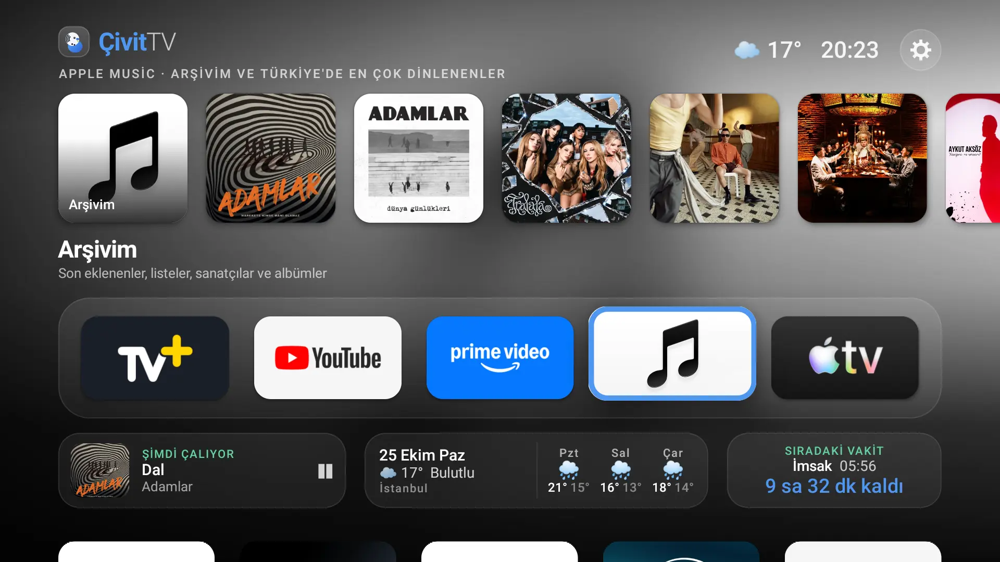

# ÇivitTV

An Apple TV 4K–style home screen for Android TV, plus PowerShell scripts that debloat the TV boxes
and phones it runs alongside. Built for a Xiaomi Mi Box S (MIBOX4, Android TV 9) on a Samsung
UE40JU7000, with a Turkish UI (English fallback).



## What's in the launcher

- **Dock of favourite apps.** A frosted-glass row you can reorder (hold OK), hide apps from, or uninstall
  from (hold OK → *Kaldır*). Pressing Home while already home jumps back to the first app.
- **Shelf above the focused app**, like tvOS "Top Shelf":
  - **TV+** (Turkcell): the channels you watched last, then the most popular live channels. Any
    channel you watch is recorded, including ones you open inside TV+ itself.
  - **Netflix, Prime Video, Disney+, Apple TV, HBO Max…**: popular titles on that service in
    Türkiye, from TMDB.
  - **Other apps**: what you recently played in them.
- **Info strip**:
  - **Son Oynatılan**: what's playing now, or what played last.
  - **Weather**: today, plus the next three days.
  - **Ezan vakti**: the next prayer time for Esenyurt/İstanbul and a countdown. The countdown turns red
    in the last 30 minutes and blinks red each time you return home in that window. It blinks white
    when the ezan time comes.
- **Ezan notices over any app.** 30 minutes before each ezan and when it arrives, a card appears at
  the top of the screen for 5 seconds with birdsong. Media that's playing is paused.
- **Remote "mouse mode" for phone-only apps.** Sideloaded phone apps with no TV interface can get an
  on-screen pointer: arrows move it (hold to glide), OK taps, hold OK long-presses, and pushing against
  an edge scrolls. MENU toggles it. The pointer appears only inside those apps; none are listed by
  default (see *Extras* below).
- **Switching launchers.** The *ÇivitTV* tile in the stock Google TV launcher (and the classic-home
  tile in ÇivitTV) switches between the two. Classic mode is temporary: a reboot always lands on ÇivitTV.
- **Small touches**: soft bird-chirp navigation sounds, a blue focus border, ambient blurred
  backgrounds, a clock and weather in the header, and a layout kept inside the TV's safe area.

### How it works

| Piece | File(s) |
|---|---|
| Home screen (Jetpack Compose) | `HomeScreen.kt`, `HomeWidgets.kt`, `MainActivity.kt` |
| Dock apps and banners | `AppRepository.kt`, `Blur.kt` |
| Shelf content | `Shelves.kt`, `Tmdb.kt`, `TvPlusChannels.kt` |
| Now playing and play history (media sessions) | `NowPlaying.kt` |
| Weather (Open-Meteo) | `Weather.kt` |
| Prayer times (Diyanet, via ezanvakti.emushaf.net) | `Ezan.kt`, `EzanNotice.kt`, `EzanChime.kt` |
| Mouse mode, TV+ channel tracking, on-top notices (accessibility service) | `MouseService.kt`, `A11yGuard.kt` |
| Launcher switching (local adb over loopback, via dadb) and boot handling | `SwitchActivity.kt`, `BootReceiver.kt` |
| Hooks for extras kept outside the repo | `LauncherExtras.kt` |
| Interface sounds (synthesised, no audio files) | `UiSounds.kt` |

Package: `com.tvenhance.home`, minSdk 24, targetSdk 35. Release builds are R8-minified and signed
with the local debug key, because Compose debug builds are slow on TV boxes.

## Build and install

Requirements: JDK 17+, the Android SDK (platform 35), `adb` on your PATH, and the TV with
*USB debugging* / *network debugging* enabled, on the same network.

Every script takes `-Device <tv-ip>:5555`. To skip typing it, set it once per PowerShell session:
`$env:TV_DEVICE = "<tv-ip>:5555"`.

```powershell
copy launcher\local.properties.example launcher\local.properties   # then fill it in
cd launcher
.\gradlew.bat assembleRelease
cd ..
.\install-launcher.ps1 -Device <tv-ip>:5555
```

`install-launcher.ps1`:

- installs the APK and makes ÇivitTV the home screen (it disables, but doesn't remove, the stock
  launcher);
- switches on mouse mode;
- grants `WRITE_SECURE_SETTINGS`, so the launcher can turn mouse mode back on if Android drops it;
- allows the media-session listener.

`.\install-launcher.ps1 -Revert` goes back to the stock launcher.

## Extras

`LauncherExtras.kt` is a small hook for app-specific additions that don't belong in this
repository: which phone-only apps get the pointer, TV banners for apps that ship without one, and
custom shelves. If `launcher/app/src/personal/` exists, the build compiles it in (Kotlin sources,
resources and an optional `AndroidManifest.xml`). Otherwise `src/stock/` provides an `Extras` that
adds nothing. `src/personal/` is git-ignored.

## Debloat scripts

Each script removes packages for the current user only (`pm uninstall --user 0`). The system
image is untouched, so `-Restore` (or a factory reset) brings everything back.

| Script | Device | Removes |
|---|---|---|
| `debloat.ps1` | Xiaomi Mi Box S (Android TV 9) | Alphonso ACR, Xiaomi analytics, PatchWall/Mi Channel promos, silent app installer, Play Games/Movies, Mi casting, and the firmware updater (disabled) |
| `debloat-philips.ps1` | Philips UHD Android TV 2021/22 (Android 11) | Usage logging, sponsored rows and recommendations, silent installer, shop demo, Alexa, Mimi, Calman, and region-only operator/Freeview apps |
| `debloat-huawei.ps1` | Huawei Mate 20 Pro (EMUI 10.1) | Huawei telemetry, preinstalled Facebook services, Magazine Unlock, recommendations, Quick Apps, Tips, Karaoke, Huawei Video/Music, Play Music/Movies |

```powershell
.\debloat.ps1 -Device <tv-ip>:5555
.\debloat.ps1 -Device <tv-ip>:5555 -Restore
```

They deliberately keep streaming apps, Chromecast, Google Assistant, the TV tuner, and anything
calls, messages or banking apps depend on.

## Data sources

- [TMDB](https://www.themoviedb.org/) for movie/series shelves (needs a free API key; this product
  uses the TMDB API but is not endorsed or certified by TMDB).
- [tvplus.com.tr](https://tvplus.com.tr/canli-tv) channel list.
- [Open-Meteo](https://open-meteo.com/) for weather and geocoding.
- [ezanvakti.emushaf.net](https://ezanvakti.emushaf.net/) for Diyanet prayer times.

## License

[MIT](LICENSE). This is a personal project for my own devices. It isn't affiliated with Apple, Google,
Xiaomi, Philips, Huawei, Turkcell or any other company mentioned. Netflix, TV+ and the other apps
and logos belong to their respective owners.
